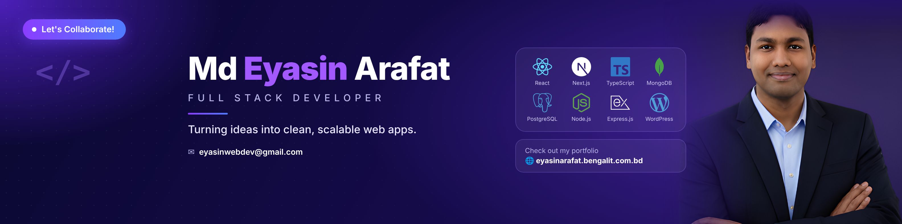

  

<h1 align="center">
  
</h1>

<h3 align="center">
  Remote MERN Stack Developer at <a href="https://bengalit.com.bd/">Bengal-IT</a>
</h3>

  Full Stack Developer | React.js | Next.js | TypeScript

  
  

### 👨‍💻 About Me

- 👋 Hi, I'm **Md. Eyasin Arafat**, a **Remote MERN Stack Developer at [Bengal-IT](https://bengalit.com.bd/)**.
- 🌱 Advancing my skills in **Advanced Backend Development, AI Engineering & Scalable Software Architecture**.
- 💻 Building [**StyleHub**](https://style-hub-brown.vercel.app/) — A modern fashion e-commerce platform.
- 🛠️ Exploring [**Developers Club**](https://subscription-based-project.vercel.app/) — A WordPress developer platform hub.
- 🚀 Interested in **SaaS products, real-world projects, innovative web applications & open-source collaboration**.
- 🌐 Portfolio: [eyasinarafat.bengalit.com.bd](https://eyasinarafat.bengalit.com.bd/)
- 📫 Email: **[eyasinwebdev@gmail.com](mailto:eyasinwebdev@gmail.com)**

<h3 align="left">🌐 Follow Me On Social</h3>

  
  
  
  

<h2 align="left">
  
  TECHNOLOGY STACK:
</h2>
<h3 align="left">Languages & Tools:</h3>

  
  
  
  

<h4>Frontend Frameworks & Libraries</h4>

<h4>Backend & Database</h4>

<h4>CMS & Platforms</h4>

<h4>Design Tools</h4>

<h4>Deployment & Version Control</h4>

<h3 align="center">📊 GitHub Statistics & Analysis</h3>

  
  

  

<h2 align="center">🐍 GitHub Contribution Snake</h2>

  

